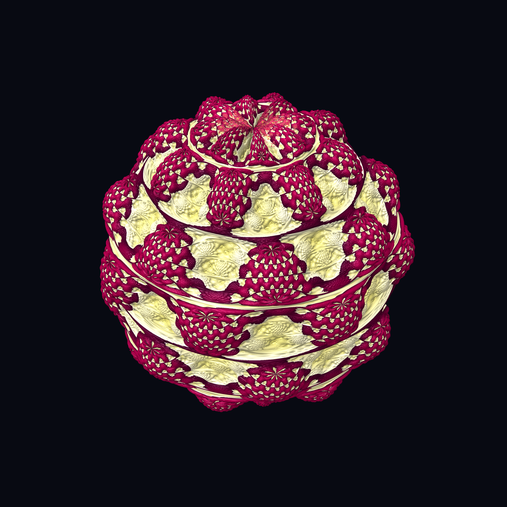
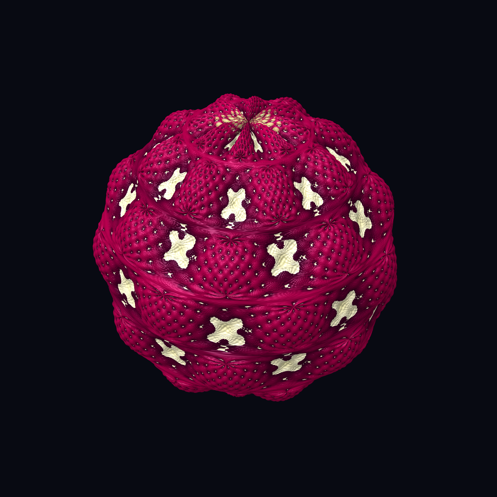
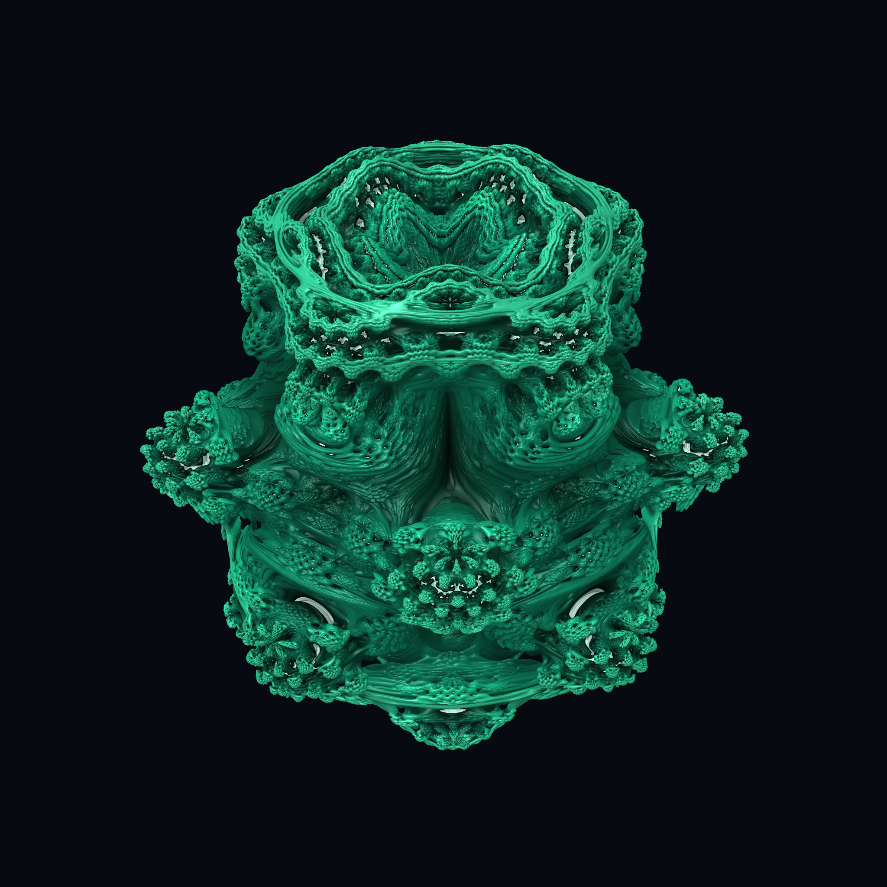
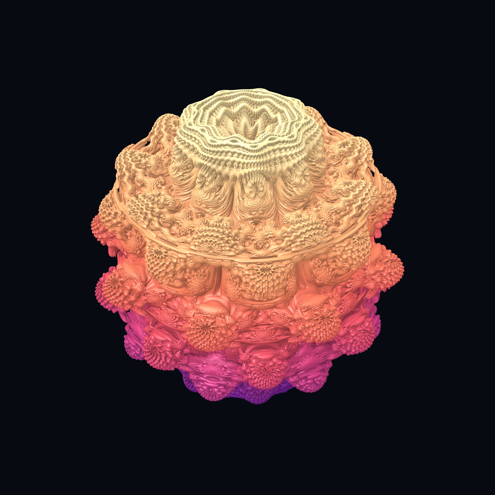
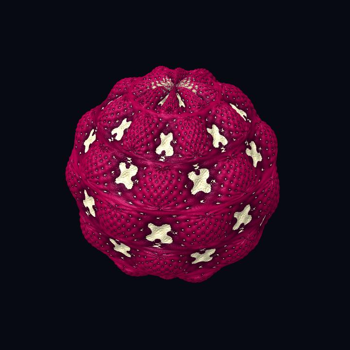

[](https://github.com/SKR-35/Mandelbulb-Viewer/actions/workflows/ci.yml)

# Mandelbulb Viewer

**An interactive Python desktop explorer for three-dimensional Mandelbulb and Julia Bulb fractals, with CPU-accelerated ray marching, dynamic geometry and cinematic animation export.**

Mandelbulb Viewer turns nonlinear three-dimensional iterations into explorable mathematical landscapes. Orbit intricate surfaces, investigate fine geometric structures, experiment with Julia constants and create still images or animations directly from numerical calculations.

The application combines a lightweight Tkinter interface with Numba-accelerated rendering. It is designed for mathematical exploration, computational art and experimentation with nonlinear dynamical systems. Every visualization is computed from the fractal model rather than generated from static image assets.

## Visualization Showcase

<p align="center">
  Selected high-resolution Mandelbulb and Julia Bulb renders,
  generated using 2× supersampling (4 samples per pixel).
</p>

<table>
  <tr>
    <td align="center" width="25%">
      <a href="docs/julia-bulb_geoz_p8_it24_orbit-trap_2048x2048_cx-0.5_cy0.3_cz0.2_ss2.png">
        
      </a>
      <b>Golden Coral II</b><br>
      <sub>Julia Bulb · Power 8</sub>
    </td>
    <td align="center" width="25%">
      <a href="docs/julia-bulb_geoz_p8_it24_orbit-trap_2048x2048_cx0.35_cy0.2_cz0.1_ss2.png">
        
      </a>
      <b>Golden Coral</b><br>
      <sub>Julia Bulb · Power 8</sub>
    </td>
    <td align="center" width="25%">
      <a href="docs/mandelbulb_jade_p6_it24_orbit-trap_2048x2048_ss2.png">
        
      </a>
      <b>Jade Bloom</b><br>
      <sub>Mandelbulb · Power 6</sub>
    </td>
    <td align="center" width="25%">
      <a href="docs/mandelbulb_magma_p10_it24_height_2048x2048_ss2.png">
        
      </a>
      <b>Magma Cathedral</b><br>
      <sub>Mandelbulb · Power 10</sub>
    </td>
  </tr>
</table>

<p align="center">
  <sub>2048 × 2048 pixels · Click any image to explore the full-resolution render.</sub>
</p>

### Animated Demonstration — Julia Bulb Morph

<p align="center">
  
</p>

<p align="center">
  <b>Golden Coral — Dynamic Julia Bulb Morph</b><br>
  <sub>720 × 720 · 24 FPS · 144 frames · 2× supersampling</sub>
</p>

The camera remains stationary while the Julia constant
varies continuously over time, revealing the dynamic
geometry of three-dimensional nonlinear iterations.
Each frame is independently computed from the
underlying mathematical model.

## Highlights

- **Two fractal models:** classical Mandelbulb and a three-dimensional Julia variant with independently adjustable constants.
- **Interactive camera:** orbit, pan and field-of-view zoom.
- **Dynamic geometry:** continuous power morphing and periodic Julia-parameter animation.
- **Advanced camera paths:** Deep Zoom, Spiral Dive and experimental Fractal Flythrough.
- **18 palettes and 18 presets:** curated combinations of geometry, color mapping and shading.
- **Four coloring modes:** radial, height, angular and spherical orbit-trap mapping.
- **Surface shading:** diffuse and specular lighting, approximate ambient occlusion, gamma and exposure controls.
- **Progressive rendering:** responsive background previews and optional 2 × 2 supersampling.
- **CPU acceleration:** parallel Numba kernels, configurable thread count and compatible geometry/shading caches.
- **Export:** PNG images, animated GIFs and MP4 videos with configurable dimensions, frame rate and duration.
- **Batch gallery:** command-line generation of reproducible preset images and animations.
- **Quality checks:** automated tests, Ruff and GitHub Actions CI configuration.

## Mathematical model

The Mandelbulb extends the idea of complex polynomial iteration into three-dimensional space using a spherical-coordinate power transformation. For a vector with spherical coordinates $(r,\theta,\phi)$, define

$$
P_p(\mathbf z)=r^p\begin{pmatrix}\sin(p\theta)\cos(p\phi)\\\sin(p\theta)\sin(p\phi)\\\cos(p\theta)\end{pmatrix}.
$$

The iteration is

$$
\mathbf z_{n+1}=P_p(\mathbf z_n)+\mathbf c.
$$

### Mandelbulb and Julia Bulb

| Model | Initial state | Constant |
| --- | --- | --- |
| Mandelbulb | Origin (the implementation skips the trivial first update) | Spatial sample point |
| Julia Bulb | Spatial sample point | Fixed vector $(c_x,c_y,c_z)$ |

The Mandelbulb visualizes a parameter-space construction, while the Julia Bulb visualizes initial conditions for a fixed transformation. The latter is analogous to a complex Julia set, but uses a spherical power map rather than ordinary complex multiplication.

Changing the power modifies the transformation itself. Changing the Julia constant modifies the dynamical system, making it possible to animate the geometry without moving the camera.

### Distance estimation and ray marching

For escaped trajectories, the renderer uses the approximate exterior distance estimate

$$
D\approx\frac{r\log r}{2d_r}.
$$

The scalar derivative estimate is updated using

$$
d_{r,n+1}=p r_n^{p-1}d_{r,n}+\delta,
$$

where $\delta=1$ for Mandelbulb and $\delta=0$ for Julia Bulb.

Rays advance through the scene using distance estimates until they approach a surface or reach a termination condition. Surface normals are approximated by finite differences and lighting combines diffuse and Blinn–Phong specular terms with approximate ambient occlusion.

These scalar estimates are rendering approximations, not certified distances or rigorous membership tests.

## Installation

### Requirements

- Python **3.12**
- [uv](https://docs.astral.sh/uv/)
- A desktop environment with Tkinter support

```bash
git clone https://github.com/SKR-35/Mandelbulb-Viewer.git
cd Mandelbulb-Viewer
uv sync
uv run python -m mandelbulb_viewer
```

The application uses NumPy, Numba, Pillow, Matplotlib, SciPy and ImageIO with FFmpeg support for video export. Tkinter is supplied by the Python installation. The first accelerated render may take longer while Numba compiles its kernels.

## Using the viewer

1. Select **Mandelbulb** or **Julia Bulb**.
2. Choose a preset or adjust the power and iteration count.
3. For Julia Bulb, adjust **Cx**, **Cy** and **Cz** using the sliders or numeric inputs.
4. Left-drag to orbit, right-drag to pan and scroll to zoom.
5. Customize the palette, coloring mode and lighting.
6. Select a rendering quality and CPU thread count.
7. Use **Export** to save an image or animation.

| Quality | Canvas render budget | Sampling |
| --- | --- | --- |
| Preview | Up to 240 pixels on the longest edge | 1 sample per pixel |
| Normal | Up to 480 pixels on the longest edge | 1 sample per pixel |
| High | Up to 900 pixels on the longest edge | 4 samples per pixel |

Export resolution is independent of the interactive canvas. Higher iteration counts, larger images and supersampling increase computation time.

## Preset gallery

Presets combine mathematical and visual parameters; they are more than palette selections.

| Preset | Palette | Power | Coloring |
| --- | --- | ---: | --- |
| Classic Rainbow | Yikique | 8 | Angular |
| Golden Coral | Geoz | 8 | Orbit trap |
| Pearl Sculpture | Pearl | 8 | Height |
| Jade Bloom | Jade | 6 | Orbit trap |
| Plasma Nebula | plasma | 9 | Height |
| Viridian Crown | viridis | 7 | Angular |
| Magma Cathedral | magma | 10 | Height |
| Inferno Forge | inferno | 8 | Radial |
| Turbo Spectrum | turbo | 9 | Angular |
| Cividis Relic | cividis | 6 | Height |
| Twilight Dream | twilight | 8 | Angular |
| Sunset Blossom | SoftSunset | 5 | Height |
| Terrestrial Sky | EarthAndSky | 7 | Height |
| Ocean Reef | Seashore | 9 | Orbit trap |
| Emerald Canopy | Forest | 6 | Radial |
| Fire and Ice | HotAndCold | 8 | Angular |
| Pastel Porcelain | Pastel | 5 | Angular |
| Obsidian Relief | Grayscale | 10 | Height |

## Image and animation export

The export dialog supports PNG, GIF and MP4. Suggested filenames encode selected scene and export parameters. For exact reproducibility, also retain camera and shading settings.

| Animation | Behavior |
| --- | --- |
| Camera Orbit | Rotates the camera around the fractal |
| Power Morph | Changes the fractal power over time |
| Palette Cycle | Animates color mapping without changing geometry |
| Zoom | Moves through a forward-and-back zoom cycle |
| Deep Zoom | Approaches the first surface along the viewing direction |
| Spiral Dive | Adds lateral spiral motion to the surface approach |
| Fractal Flythrough | Experimental exterior approach with lateral steering |
| Julia Bulb Morph | Changes Julia constants with a fixed camera |
| Julia Bulb Orbit | Combines Julia morphing with camera rotation |

Advanced camera paths use approximate surface-clearance checks and adaptive rendering tolerances. They are one-way sequences, not seamless loops. Flythrough does not guarantee navigation through arbitrary cavities.

Julia animations follow periodic paths through the three-dimensional constant space. Each frame is recalculated from its own mathematical parameters, rather than interpolating previously rendered images.

## Batch gallery generation

Inspect available options:

```bash
uv run python -m mandelbulb_viewer.gallery --help
```

Preview the output filenames without rendering:

```bash
uv run python -m mandelbulb_viewer.gallery --dry-run
```

Generate the complete preset collection:

```bash
uv run python -m mandelbulb_viewer.gallery --width 1200 --height 1200 --output gallery
```

Generate the Golden Coral showcase image:

```bash
uv run python -m mandelbulb_viewer.gallery --fractal julia --cx 0.35 --cy 0.20 --cz 0.10 --preset "Golden Coral" --width 2048 --height 2048 --samples 2 --threads 4 --output gallery/showcase
```

Generate a Julia morph animation:

```bash
uv run python -m mandelbulb_viewer.gallery --fractal julia --preset "Golden Coral" --format gif --animation "Julia Bulb Morph" --width 480 --height 480 --fps 12 --seconds 6 --samples 2 --output gallery/videos
```

Existing files are skipped unless `--overwrite` is supplied. Repeat `--preset` to select multiple scenes. Completed outputs can be retained when interrupting a batch.

### Export limits and performance

- Maximum width and height are 4096 with `--samples 1` or 2048 with `--samples 2`.
- Supersampling doubles each internal dimension and quadruples the primary ray count.
- MP4 dimensions must be even.
- GIF generation is subject to a memory-budget check; use MP4 for larger sequences.
- Start with small previews before committing to high-resolution animations. Rendering cost depends on geometry, ray steps, iterations, sampling and hardware.

## Architecture

The application is organized under `src/mandelbulb_viewer/`.

| Module | Responsibility |
| --- | --- |
| `__main__.py` | Application entry point |
| `gui.py` | Tkinter interface and interactive controls |
| `core.py` | Fractal iteration and distance estimation |
| `camera.py` | Perspective camera and navigation |
| `camera_paths.py` | Advanced camera trajectories |
| `render.py` | Parallel ray marching and rendering |
| `lighting.py` | Surface shading and lighting |
| `progressive.py` | Progressive rendering and sampling configuration |
| `palettes.py` | Color palettes |
| `presets.py` | Named scene configurations |
| `export.py` | Image and animation generation |
| `export_dialog.py` | Export interface |
| `gallery.py` | Command-line batch generation |

Numerical kernels are separated from the desktop interface to support automated testing and headless gallery generation. Compatible geometry and shading results can be reused, including during palette-cycle animations.

## Development and quality checks

```bash
uv sync --group dev
uv run ruff check .
uv run ruff format --check .
uv run pytest -q
```

For coverage in PowerShell, disable JIT compilation temporarily:

```powershell
$env:NUMBA_DISABLE_JIT = "1"
uv run pytest --cov=mandelbulb_viewer --cov-report=term-missing
Remove-Item Env:NUMBA_DISABLE_JIT
```

The GitHub Actions workflow runs dependency installation, Ruff checks and pytest on pushes and pull requests. JIT-disabled coverage complements rather than replaces tests of accelerated execution.

## Numerical interpretation and limitations

- Finite iteration counts cannot prove fractal membership.
- Distance estimates, surface normals and ambient occlusion are numerical approximations.
- Deep zoom is limited by floating-point precision, ray-step budgets and surface tolerances.
- Julia constants can produce disconnected, empty-looking or poorly resolved geometry.
- The spherical power map is not ordinary complex or quaternion exponentiation.
- Rendering is CPU-based; high-resolution animations may require substantial computation.